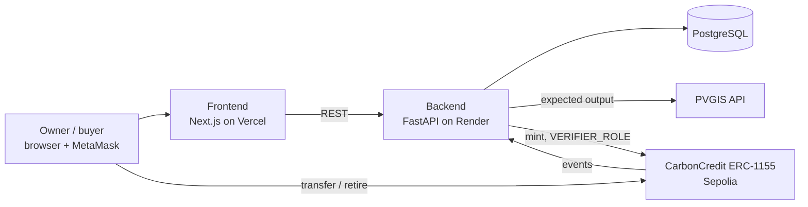

# CarbonCredit Guardian

**Verify first, then mint.** CarbonCredit Guardian checks the production data of renewable energy projects with a physics model and an AI anomaly detector *before* any carbon credit is created. Only verified projects can mint credits on-chain, and anyone can check where every credit came from and whether it has already been used.

Built for the **IEEE ClimateChain Global Hackathon 2026**. Track: *Carbon Markets & Emissions Transparency*.

| | |
|---|---|
| Live app | https://carboncredit-guardian.vercel.app |
| API docs | https://carboncredit-guardian.onrender.com/docs |
| Smart contract (Sepolia) | [`0x11d92Ad43f36Fc0598B5BeF8B8667939977E4083`](https://sepolia.etherscan.io/address/0x11d92Ad43f36Fc0598B5BeF8B8667939977E4083) |
| Demo video | YOUR-VIDEO-LINK |

> The backend runs on a free Render instance and sleeps when idle. The first request can take about a minute.

## The problem

A carbon credit is supposed to prove that one tonne of CO2 was really avoided. In practice, many credits are based on numbers that the project owner reports and nobody independently checks. A solar plant can report more energy than it produced and receive extra credits. A buyer has no easy way to see whether a credit is backed by real production, or whether it was already retired by someone else.

## How it works

1. **Submit.** The owner enters the plant's location, installed capacity, wallet address and 12 months of reported production.
2. **Physical check.** The backend asks the EU's [PVGIS](https://joint-research-centre.ec.europa.eu/photovoltaic-geographical-information-system-pvgis_en) model what a plant with this capacity can produce at these coordinates under ideal panel angles. Reports above 110% of the annual best case, or months above the expected value plus the normal year-to-year variation, are physically implausible.
3. **AI check.** An Isolation Forest, trained per location on 400 simulated honest plants, scores each month. It catches what a simple limit misses: numbers that are too smooth, or energy moved between seasons while the yearly total looks normal.
4. **Risk score.** Both layers are combined into a score from 0 to 100. A score of 30 or more flags the project for review, and no credits can be minted.
5. **Mint.** For a verified project, the backend calls the ERC-1155 contract with its verifier role. One credit equals one tonne of CO2, calculated with Türkiye's official grid emission factor (0.6345 tCO2/MWh). The risk score is stored in the on-chain event.
6. **Trade and retire.** Owners transfer credits from their own wallet. Retiring credits burns them, with a beneficiary and a reason, so they can't be sold again.
7. **Public verification.** `/verify/{id}` shows the full history of a project's credits (minted, transferred, retired, outstanding), each entry linked to its transaction. No wallet needed, and there's a QR code for certificates.

## Architecture



The contract is the source of truth for ownership. The backend indexes its events (`CreditsMinted`, `CreditsRetired`, `TransferSingle`, `TransferBatch`) into PostgreSQL so the public history page loads fast.

| Part | Stack |
|---|---|
| Frontend | Next.js, TypeScript, wagmi/viem, MetaMask |
| Backend | Python, FastAPI, SQLAlchemy, scikit-learn, web3.py |
| Smart contract | Solidity, OpenZeppelin ERC-1155 + AccessControl, Foundry |
| Infrastructure | Vercel, Render (web service + PostgreSQL), Ethereum Sepolia |

## Repository layout

```
backend/     FastAPI service: verification, AI model, minting, event indexer
frontend/    Next.js app
contracts/   Solidity contract and Foundry tests
```

## Run locally

**Backend** (Python 3.12+)
```bash
cd backend
python -m venv .venv
source .venv/bin/activate          # Windows: .venv\Scripts\activate
pip install -r requirements.txt
uvicorn app.main:app --reload      # http://localhost:8000/docs
```
Without any configuration it uses SQLite, and verification works. To mint, create `backend/.env`:
```
SEPOLIA_RPC_URL=https://ethereum-sepolia-rpc.publicnode.com
CONTRACT_ADDRESS=0x11d92Ad43f36Fc0598B5BeF8B8667939977E4083
VERIFIER_PRIVATE_KEY=<a Sepolia test key that has VERIFIER_ROLE>
```
Optional: `DATABASE_URL` (PostgreSQL), `CORS_ORIGINS` (comma-separated). Demo data: `python scripts/seed_demo.py --owner <wallet> --base-url http://localhost:8000`.

**Frontend**
```bash
cd frontend
npm install
echo "NEXT_PUBLIC_API_URL=http://localhost:8000" > .env.local
npm run dev                         # http://localhost:3000
```

**Contract**
```bash
cd contracts
forge test
```

## API overview

| Method | Path | Purpose |
|---|---|---|
| POST | `/projects` | Submit a project and run verification |
| GET | `/projects`, `/projects/{id}` | List / detail with verification results |
| POST | `/projects/{id}/verify` | Re-run verification |
| POST | `/projects/{id}/mint` | Mint credits for a verified project |
| GET | `/credits/{id}/history` | Public credit history from on-chain events |
| GET | `/pvgis/expected` | Expected monthly output for a location |
| POST | `/chain/sync` | Index new contract events |

Full interactive docs: `/docs`.

## Responsible design

CarbonCredit Guardian decides which projects are allowed to create carbon credits. A decision like that has to be explainable, fair to honest producers and easy to check from outside. This section explains how we handle that and where the prototype still falls short.

### Transparency: every decision can be explained

- **No black-box score.** Every verification returns the reasons behind it: which months exceeded the physical limit, which months the AI model flagged, and how far the annual total is from the PVGIS estimate. The project page shows the expected curve, the reported bars and the flagged months side by side.
- **Open reference data.** The physical limit comes from the EU's public PVGIS model (JRC, v5.3). The CO2 factor is Türkiye's official combined-margin grid emission factor for solar and wind, 0.6345 tCO2/MWh (TUESEF 2021, Ministry of Energy). Anyone can recompute both.
- **Public credit history.** The `/verify/{id}` page needs no wallet or account. It shows every mint, transfer and retirement, each linked to its transaction on Sepolia Etherscan.

### Accountability: who can do what

- **Only verified projects are minted.** The backend refuses to mint a project unless it passed verification, and refuses to mint the same project twice.
- **Role-based minting on-chain.** The contract only accepts `mint` calls from an address with `VERIFIER_ROLE`. The admin can revoke the role at any time, for example if the verifier key leaks.
- **The risk score is stored on-chain.** Every `CreditsMinted` event includes the risk score the project had when it was approved, so the decision is part of the permanent record.
- **No double counting.** Retiring credits burns them and emits `CreditsRetired` with a beneficiary and a reason. Retired credits can't be transferred or sold again.

### Fairness: avoiding false accusations

- **Measured false-positive rate.** We ran the full pipeline on 500 simulated honest plants. About 0.6% were wrongly flagged. We set the thresholds to keep this number low, because wrongly blocking an honest producer is a real cost.
- **Flagging means "needs review", not "fraud".** A flagged project gets no credits, but it isn't punished. The owner sees the reasons and can submit corrected data. In a production system, flagged projects would go to a human reviewer.
- **Conservative crediting.** Even an approved project never gets credits for more energy than the physical best case for its location.
- **Two independent signals.** A project is flagged if the reported output is physically impossible, or if the monthly pattern doesn't look like a real solar plant at that location. Neither layer has to be perfect on its own.

### Security and privacy

- The verifier's private key exists only as an environment variable on the server. It is never in the repository, the frontend or the browser.
- Transfers and retirements are signed by the credit owner in their own wallet. The backend can't move anyone's credits.
- We store no personal data: only project name, coordinates, capacity, monthly production and a wallet address. All of it is meant to be public for verification.

### Known limitations

- **Self-reported data.** Production numbers are entered by the owner. The system catches implausible numbers, not small, realistic-looking lies. A real deployment should read data directly from smart meters or the grid operator.
- **Synthetic training data.** The anomaly model is trained on honest plants simulated from PVGIS for each location, not on real fraud cases. Because there is no labeled fraud dataset, its detection rate on real-world fraud is unknown.
- **Solar only, Türkiye only.** The physical model and the emission factor fit solar plants in Türkiye. Other technologies or countries need their own reference data.
- **One verifier key.** Minting depends on a single trusted backend. A production version should use several independent verifiers, for example a multisig.
- **On-chain rules are minimal.** The contract checks who mints, but it doesn't check the risk score itself. That check happens in the backend.
- **Testnet.** Everything runs on Sepolia with test ETH. These credits have no monetary value and aren't certified by any standard such as Verra or Gold Standard.

## Team

- **Yusuf Öztoprak**: backend, verification and AI model, on-chain integration
- **Noel Eruotor**: frontend, smart contract

## Data sources

- PVGIS v5.3, European Commission Joint Research Centre: expected PV output and year-to-year variation.
- Republic of Türkiye Ministry of Energy and Natural Resources, TUESEF 2021 emission factor information form: 0.6345 tCO2/MWh combined margin for solar and wind.
